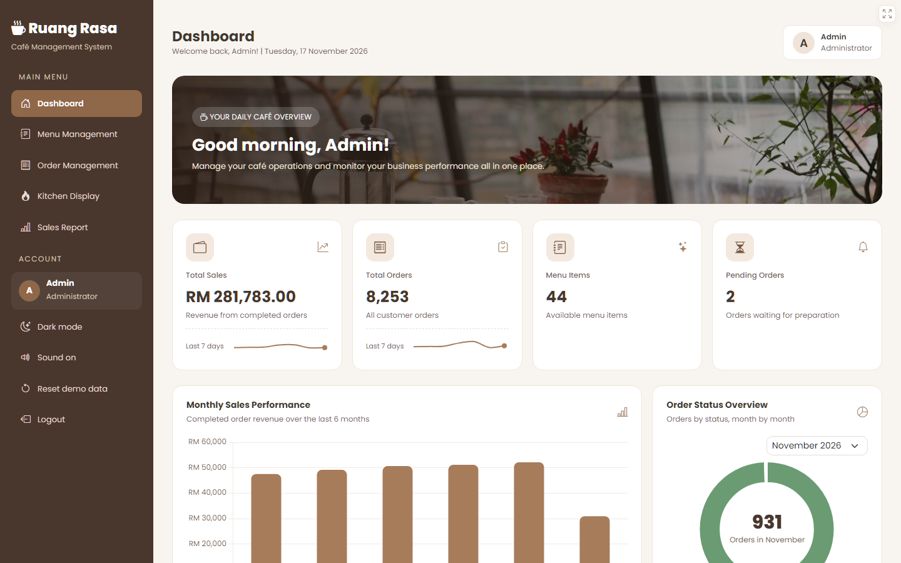
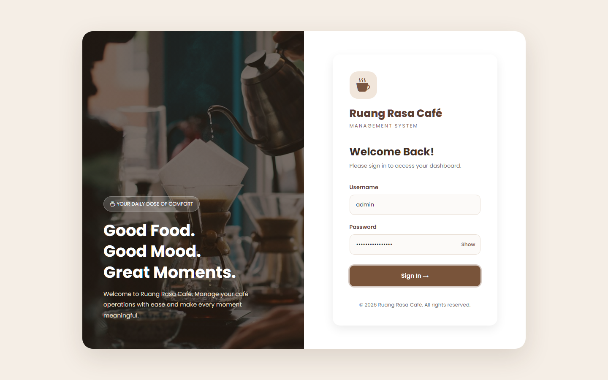
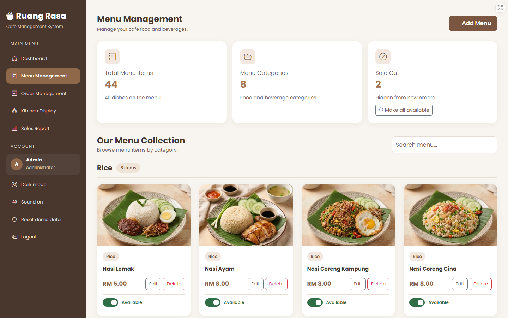
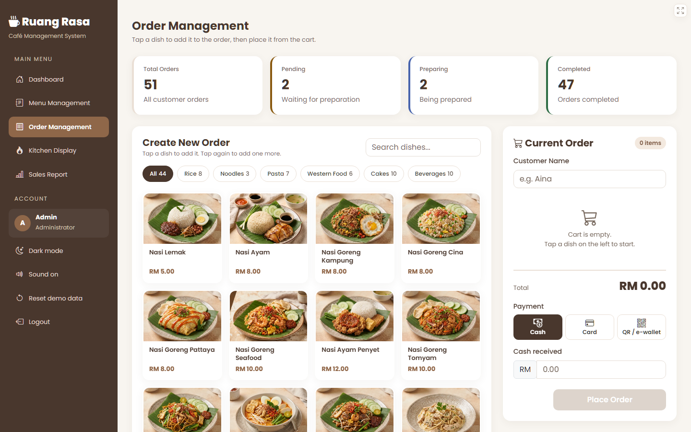
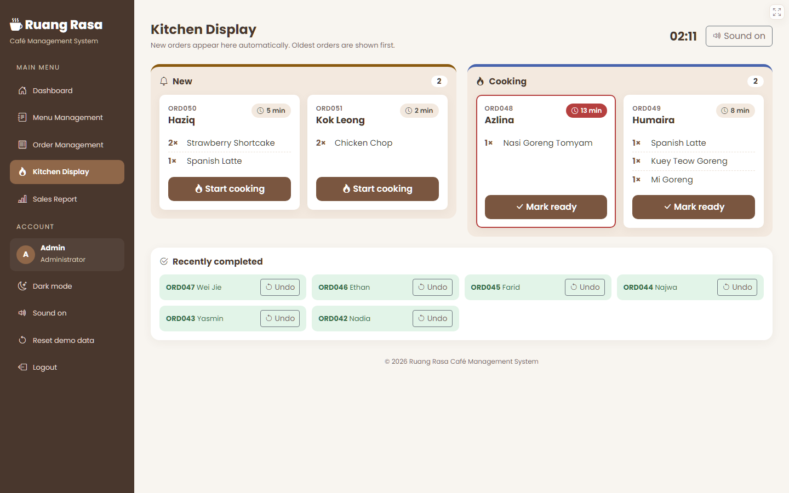
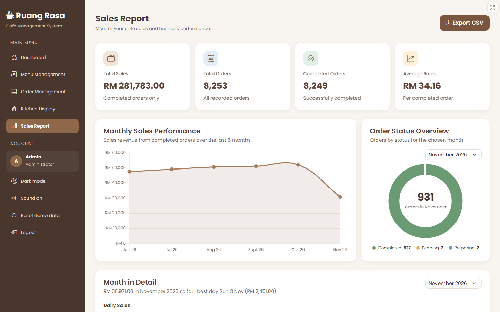
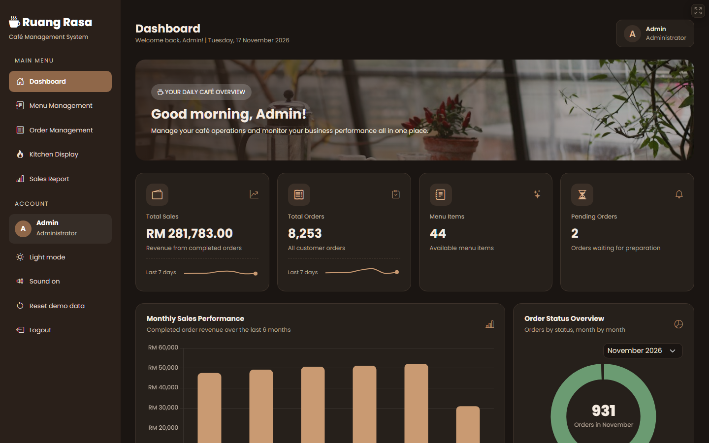
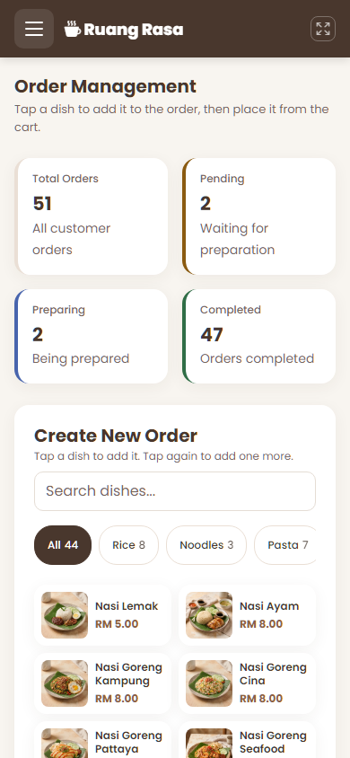

# ☕ Ruang Rasa Café Management System

A web-based management system for **Ruang Rasa Café**, a small Malaysian café serving rice and noodle dishes, pasta, western food, cakes and drinks.

Staff use it to take orders, send them to the kitchen, manage the menu and follow sales. It runs entirely in the browser: there is no server or database to install. All data is saved in the browser's `localStorage`, and the app comes with realistic demo data (today's orders plus 6 months of sales history), so every page has something to show straight away.



---

## 📸 Screenshots

<table>
  <tr>
    <td width="50%"><b>Login</b><br></td>
    <td width="50%"><b>Menu Management</b><br></td>
  </tr>
  <tr>
    <td><b>Order Management (point of sale)</b><br></td>
    <td><b>Kitchen Display</b><br></td>
  </tr>
  <tr>
    <td><b>Sales Report</b><br></td>
    <td><b>Dark mode</b><br></td>
  </tr>
</table>

<p align="center">
  <b>Phone layout</b><br>
  
</p>

---

## ✨ Features

### 🔐 Login
- Sign-in page with a password show/hide toggle and clear error messages
- The demo account types itself into the form, so you only need to press **Sign In**
- Pages are protected: opening one without logging in sends you to the login page, then back to that page after you sign in
- Logout from any page

### 📊 Dashboard
- Greeting that changes with the time of day
- Summary cards: total sales, total orders, menu items and pending orders
- Charts: monthly sales performance, order status overview and best-selling menu items
- **Recent Orders** table: click any order to jump straight to it on the Orders page

### 🍽️ Menu Management
- 44 dishes with photos, in 6 categories: Rice, Noodles, Pasta, Western Food, Cakes and Beverages
- Add, edit and delete menu items (name, category, price and picture)
- Mark a dish as **Sold out** or **Available** with one switch
- Menu grouped by category, with a search box

### 🧾 Order Management (point of sale)
- Tap dishes to build an order in a cart, then change quantities or remove items
- Payment by **Cash** (with change calculation and quick-amount buttons), **Card** or **QR / e-wallet**
- Sold-out dishes can't be ordered
- Change an order after it's placed:
  - **Pending** orders can be changed freely
  - **Preparing** orders can only have items added
  - **Completed** orders are locked
- Update order status: Pending → Preparing → Completed
- Search orders by customer and filter by status
- Print a receipt for any order

### 👨‍🍳 Kitchen Display
- Live order tickets for the kitchen, grouped by status
- New and updated orders appear automatically (no refresh needed), with a chime and a **NEW** tag on added items
- Live clock and a sound on/off switch (same setting as the sidebar); in full screen the sidebar hides so the tickets fill the screen

### 📈 Sales Report
- Monthly sales, payment-method breakdown and best sellers, with charts
- Searchable and filterable transaction list
- **Export to CSV**: choose a report (transactions, daily summary or best sellers) and a period (this month, last 6 months or custom dates). The files open correctly in Excel.

### 🎨 General
- **Dark mode**, remembered between visits
- **Full screen** button in the top-right corner of every page. It stays on while you move between pages until you click it again (or press Esc)
- **Order alerts** on every page: a pop-up and a chime when a new order comes in or an order is ready (from another tab or window). Turn the sound off with **Sound on/off** in the sidebar
- Responsive layout for desktop, tablet and phone (sidebar becomes a slide-in menu, and tables become cards)
- Accessible: keyboard navigation, visible focus, screen-reader labels and support for "reduce motion"
- **Reset demo data** button to bring back the original menu and sample orders (handy before a presentation)

---

## 🔑 How to Test the Login

1. Download or clone this repository:
   ```bash
   git clone https://github.com/SaidatulHizari/ruang-rasa-cafe.git
   ```
2. Open **`index.html`** in a web browser (Chrome, Edge or Firefox). No installation or server is needed.
3. The login form fills itself in with the demo account:
   - **Username:** `admin`
   - **Password:** typed in automatically
4. Click **Sign In →** or press **Enter**. You will be taken to the Dashboard.

**Things you can also try:**
- **Wrong password:** clear the password field and type anything else. An error message appears and the form shakes.
- **Protected pages:** log out, then open `orders.html` directly. You are sent back to the login page, and after signing in you land on the Orders page.
- **Session:** the login lasts until you click **Logout** or close the browser tab.

> **Note:** This is a front-end demo project. The login is checked in the browser (`js/login.js`), so it is for demonstration only and is not real security.

---

## 🛠️ Frameworks & Libraries

| Technology | Purpose |
|---|---|
| **HTML5, CSS3, JavaScript (ES6)** | Page structure, styling and all app logic (no build step) |
| [**Bootstrap 5.3.3**](https://getbootstrap.com/) | Layout grid, forms, buttons and modal dialogs |
| [**Bootstrap Icons 1.11.3**](https://icons.getbootstrap.com/) | Icons throughout the interface |
| [**Chart.js 4.4.1**](https://www.chartjs.org/) | Sales and order charts on the Dashboard and Sales Report |
| [**Google Fonts: Poppins**](https://fonts.google.com/specimen/Poppins) | Typography |
| **Web Storage API** (`localStorage` / `sessionStorage`) | Saving orders, menu, settings and the login session |
| **Web Audio API** | Kitchen Display chime for new orders |

The libraries are loaded from a CDN, so an internet connection is needed the first time the pages load.

---

## 📁 Project Structure

```
ruang-rasa-cafe/
├── index.html        Login page
├── dashboard.html    Dashboard
├── menu.html         Menu Management
├── orders.html       Order Management (point of sale)
├── kitchen.html      Kitchen Display
├── sales.html        Sales Report
├── css/style.css     Shared styles (light + dark theme)
├── images/           Menu photos (WebP)
├── screenshots/      Screenshots used in this README
└── js/
    ├── auth.js       Login session and page protection
    ├── login.js      Login form and demo auto-fill
    ├── data.js       Menu, demo orders and sales history
    ├── layout.js     Sidebar, logout, dark mode, reset demo data
    ├── theme.js      Applies the saved theme
    ├── ui.js         Toasts, dialogs and shared helpers
    ├── charts.js     Chart colours and settings
    ├── menu.js       Menu Management page
    ├── orders.js     Order Management page
    └── kitchen.js    Kitchen Display page
```

---

© 2026 Ruang Rasa Café
